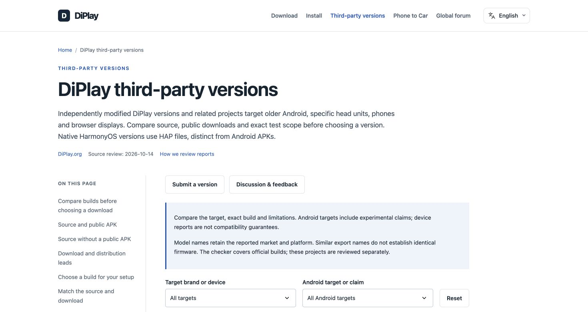
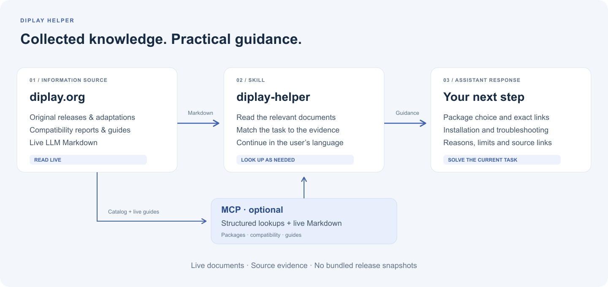

# DiPlay Helper

**English** · [简体中文](README.zh-CN.md)

A third-party Skill and read-only MCP integration for finding, installing and troubleshooting DiPlay with information collected by [diplay.org](https://diplay.org/).

We discovered **diplay.org** while looking for DiPlay versions and setup information. The community site brings together original releases, third-party adaptations, compatibility reports, download information and troubleshooting guides. We built **DiPlay Helper** to make that collection easier to use from an AI assistant: describe your head unit or the problem you are facing, and the assistant reads the relevant current documents to help with the next step.

> **Open source · MIT.** Install the Skill independently, or run the optional MCP locally. A hosted MCP endpoint is not provided.

[](https://diplay.org/community/?lang=en)

*The version directory on diplay.org, captured on October 14, 2026. This is the source website; the helper is used through your AI assistant.*

## What you can ask

| Your task | How the helper assists |
| --- | --- |
| Choose a package | Read current requirements, relevant adaptations and available compatibility evidence for your actual head unit |
| Find a download | Locate the selected package’s original distribution or a verified mirror, with its exact filename and location |
| Install or connect | Follow the relevant installation, USB or wireless instructions for the current setup |
| Troubleshoot | Continue from the current error and attempted steps using the relevant installation or symptom guidance |

For example:

> “Help me choose DiPlay for my head unit. Its actual Android version is 8.1 / API 27.”
>
> “I already downloaded the APK, but opening it gives a parsing error. What should I check next?”
>
> “CarPlay connects, but Siri audio is broken. Help me troubleshoot my installed version.”

## How it works



The Skill starts with [the site’s LLM guide](https://diplay.org/llm-guide.md), then reads only the relevant selection, release, project, download or troubleshooting Markdown. It replies in the user’s language and can work with the assistant’s existing browsing or fetch tools.

**The knowledge comes from live documents.** The Skill ships instructions rather than a fixed release list or offline knowledge snapshot. Within a conversation it can reuse documents already read, refreshing when the selected package changes, sources change, or the user requests the latest information. If required documents are unavailable, it explains which facts could not be verified.

The optional MCP adds structured lookups and returns live package or topic Markdown. It checks document hashes against the site’s catalog revision so an update cannot silently combine a new guide with old package information.

## Use the Skill

The Skill’s name is `diplay-helper`, displayed as **DiPlay Helper**. Its instructions are in [`skills/diplay-helper/SKILL.md`](skills/diplay-helper/SKILL.md).

Install with the [Skills CLI](https://github.com/vercel-labs/skills):

```sh
npx skills add UllrAI/diplay-helper --skill diplay-helper
```

Select your agent when prompted. Start a new conversation with browsing/fetch tools and ask `$diplay-helper` for help with your setup or current issue. MCP is optional.

For manual installation, copy `skills/diplay-helper` into the Skill directory supported by your agent; check before replacing an existing installation. Tagged releases also include a Skill ZIP.

## Optional MCP tools

| Tool | What it returns |
| --- | --- |
| `find_candidates` | Public APK candidates filtered by catalog brand and Android target tags, plus the guides required before recommending one |
| `get_package` | Current package details, known exact downloads and mirror identity, and the live package Markdown |
| `search_compatibility` | Individual source reports with their tested setup, version, dates and evidence level |
| `get_guide` | Live entry, selection, official release, community, download, installation or troubleshooting Markdown |

The server supports HTTP and stdio. It reads the query catalog published by diplay.org and the live Markdown linked from it. Node.js setup, source prerequisites and client configuration are in [the development guide](docs/development.md).

## Sources and practical limits

Keep the package, firmware, Android/API and CPU architecture specific. Catalog tags help locate candidates; installation requirements and vehicle compatibility must be checked against the actual documents and reports. Downloading, installing, connecting CarPlay and having working audio or calls are separate outcomes. Older or related reports retain their original scope.

Downloads follow the user’s actual access. Prefer the original project distribution where accessible. For mainland China or unreliable GitHub access, offer a verified copy of the same package when available, preserving its exact mirror folder and filename. Saving to a cloud drive is separate from downloading to the device.

DiPlay Helper is a third-party information and workflow integration. DiPlay releases are maintained by their respective developers; the collected guides and evidence come from diplay.org and its cited original sources. The helper’s software checks do not establish vehicle compatibility.

## Further reading

- [Live DiPlay LLM guide](https://diplay.org/llm-guide.md)
- [Third-party version directory](https://diplay.org/community/?lang=en)
- [Skill instructions](skills/diplay-helper/SKILL.md)
- [Development and MCP configuration](docs/development.md)
- [Review scenarios](docs/review.md) · [Validation record](docs/validation.md) · [Release procedure](docs/release.md)

Screenshot sources and editable diagrams: [image notes](docs/images/README.md).

## License

The helper code, Skill instructions and original diagrams use the [MIT License](LICENSE). Website screenshots and cited third-party material retain their original rights and attribution.
