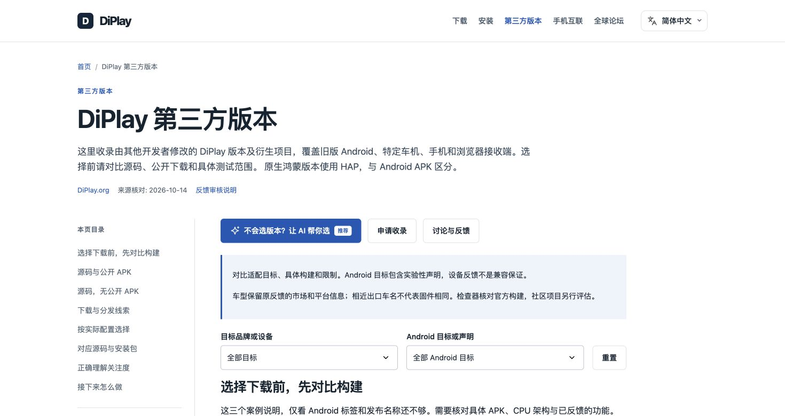
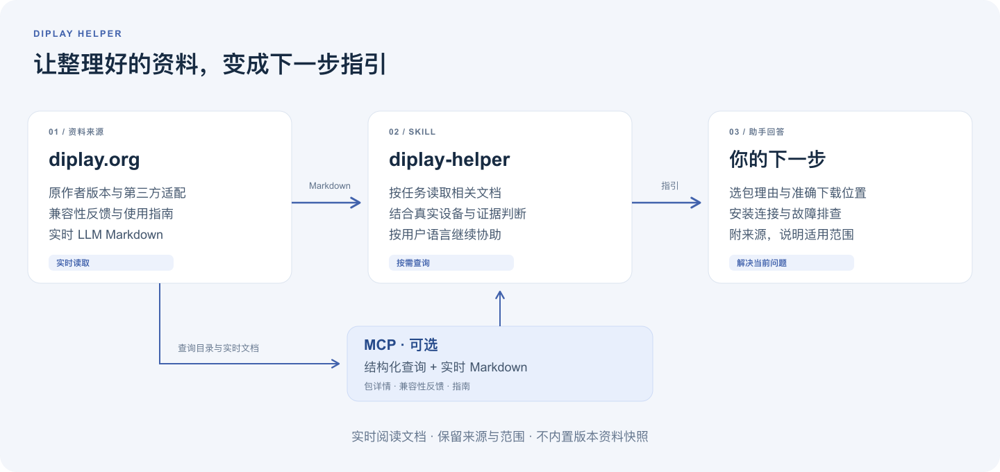

# DiPlay Helper

[English](README.md) · **简体中文**

一个第三方 **Skill 与只读 MCP**，借助 [diplay.org](https://diplay.org/zh/) 收集的资料，帮助用户选择 DiPlay、查找下载位置、安装连接和排查问题。

我们在查找 DiPlay 版本和使用信息时，发现了 **diplay.org** 这个社区资料站。它整理了原作者版本、第三方适配项目、兼容性反馈、下载信息和安装排错指引。于是我们做了 **DiPlay Helper**，让 AI 助手更方便地利用这些资料：用户描述自己的车机或当前问题，助手读取相关的最新文档，再帮助用户完成下一步。

> **私有预览：**仓库目前保留在 UllrAI 下，等待 review。尚未发布公开可安装的 Skill 或公网 MCP 服务。

*截图来自 diplay.org 的版本目录，拍摄于 2026 年 10 月 14 日。这是资料来源站点；助手通过用户的 AI 客户端使用。*

## 可以帮你做什么

| 当前任务 | 助手如何协助 |
| --- | --- |
| 选一个合适的包 | 根据实际车机读取当前安装要求、相关适配项目和兼容性证据 |
| 找到下载位置 | 查找所选包的原始分发或已核对备份，提供准确文件名和位置 |
| 安装与连接 | 按当前设备和连接方式读取安装、USB 或无线指引 |
| 解决报错 | 保留已提供的信息和已尝试的步骤，围绕当前安装或使用问题继续排查 |

例如，你可以这样问：

> “帮我给车机选 DiPlay，实际系统是 Android 8.1／API 27。”
>
> “APK 已经下载好了，打开时提示解析软件包失败，接下来该检查什么？”
>
> “CarPlay 能连接，但 Siri 没声音，帮我排查当前安装的版本。”

## 它如何工作

Skill 从 [该站点的 LLM 指引](https://diplay.org/llm-guide.md) 开始，再按当前任务读取选择规则、版本资料、具体项目、下载要求或故障分支。它按用户语言回答，可以使用 AI 客户端已有的浏览器或读取工具。

**知识来自实时文档。** Skill 包含工作指引，不内置固定版本清单或离线资料快照。同一会话可以复用已读文档；换包、资料更新或用户要求最新信息时重新核对。必要文档读不到时，助手会说明哪些事实暂时无法确认。

可选的 MCP 提供结构化查询，并返回包详情或主题的实时 Markdown。它会核对文档哈希与目录修订，避免站点更新期间把新版文档和旧版包信息混在一起。

## 使用 Skill

技能名称为 `diplay-helper`，展示名为 **DiPlay Helper**。完整指引位于 [`skills/diplay-helper/SKILL.md`](skills/diplay-helper/SKILL.md)。

私有 review 阶段可以这样使用：

1. 使用有权限的 GitHub 账号取得这个仓库。
2. 将 `skills/diplay-helper` 放到 AI 客户端支持的技能目录。Codex 对应 `~/.codex/skills/diplay-helper`；替换已有安装前先检查。
3. 在具备联网读取能力的客户端中开启新会话，使用 `$diplay-helper`，描述真实车机或当前问题。

MCP 是可选项。公开安装方式会在 review 和发布后补充。

## 可选的 MCP 工具

| 工具 | 返回内容 |
| --- | --- |
| `find_candidates` | 按品牌和 Android 目标标签筛选公开 APK 候选，并给出推荐前需要阅读的指引 |
| `get_package` | 当前包详情、准确已知下载和备份身份，以及对应的实时 Markdown |
| `search_compatibility` | 逐条原始反馈，保留实测配置、版本、日期和证据级别 |
| `get_guide` | 入口、选择、原作者版本、第三方目录、下载、安装或排错主题的实时 Markdown |

服务支持 HTTP 和 stdio，通过 diplay.org 提供的查询目录及其实时 Markdown 读取资料。Node.js 启动方式、数据源前提和客户端配置见[开发文档](docs/development.md)。

## 资料来源与使用边界

包、固件、完整 Android／API 和 CPU 架构需要分别核对。目录标签用于查找候选，安装要求和实车兼容性仍须读取具体资料与反馈。下载成功、安装成功、CarPlay 连接，以及声音和通话正常，是不同阶段；旧版本和相近配置的反馈保留各自范围。

下载渠道按实际访问条件选择。原项目可访问时优先原始分发；中国大陆用户或 GitHub 访问不稳定时，可提供已核对的同包备份，并保留准确的网盘文件夹和文件名。转存到网盘与下载到本机是两步。

DiPlay Helper 是第三方资料与工作流程集成。DiPlay 各版本由对应开发者维护，整理后的指引和证据来自 diplay.org 及其引用的原始来源。助手自身的软件检查不代表实车兼容性验证。

## 继续阅读

- [实时 DiPlay LLM 指引](https://diplay.org/llm-guide.md)
- [第三方版本目录](https://diplay.org/zh/community/)
- [Skill 完整指引](skills/diplay-helper/SKILL.md)
- [开发与 MCP 配置](docs/development.md)
- [Review 场景](docs/review.md) · [验证记录](docs/validation.md) · [发布步骤](docs/release.md)

截图来源与可编辑示意图见[配图说明](docs/images/README.md)。
