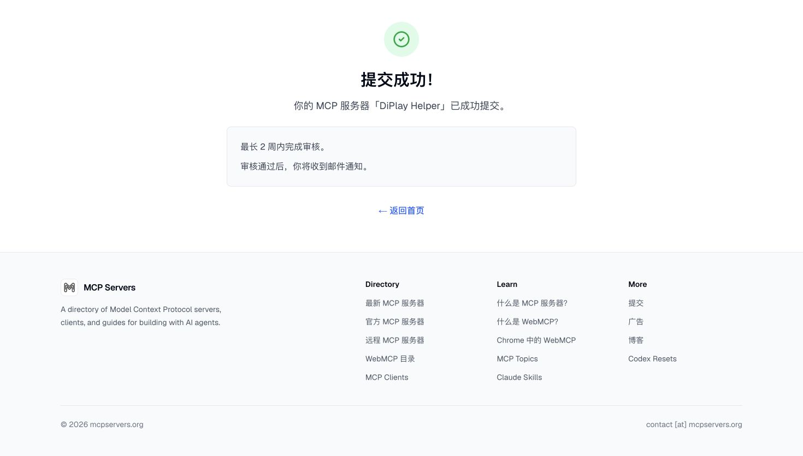

# Public distribution — 2026-10-14

Repository: [UllrAI/diplay-helper](https://github.com/UllrAI/diplay-helper), public under MIT. First release: [v0.1.0](https://github.com/UllrAI/diplay-helper/releases/tag/v0.1.0), including the Skill ZIP.

```sh
npx skills add UllrAI/diplay-helper --skill diplay-helper
```

The Skill reads live task-specific Markdown. MCP is an optional self-run TypeScript server with stdio and HTTP transports; no hosted endpoint, npm package or MCP Registry entry is advertised.

## Recommendations submitted

| Destination | Submission | Verified state on 2026-10-14 |
| --- | --- | --- |
| heilcheng/awesome-agent-skills | [PR #587](https://github.com/heilcheng/awesome-agent-skills/pull/587) | Open; awaiting maintainer review. Local website build passed. The destination's Vercel preview requires its team to authorize this external contribution. |
| libukai/awesome-agent-skills | [PR #194](https://github.com/libukai/awesome-agent-skills/pull/194) | Open; awaiting maintainer review. One entry under product use. |
| shihabal3amri/DiPlay | [Resource proposal #760](https://github.com/shihabal3amri/DiPlay/issues/760) | Open; proposed an optional third-party resource without implying endorsement or broader vehicle support. |
| wong2/awesome-mcp-servers → mcpservers.org | [Official submission form](https://mcpservers.org/submit) | Free submission completed; confirmation states review can take up to two weeks. No listing acceptance yet. |



The form used the project's public contact `feedback@diplay.org`. No paid submission was selected; the remote-endpoint checkbox and optional Registry name were left empty.

## Destinations not submitted

- VoltAgent/awesome-agent-skills requires proven community use and excludes newly created skills; defer until there is real usage evidence.
- appcypher/awesome-mcp-servers: a README entry was prepared and pushed to a fork, but GitHub rejected creation of the upstream PR with a permission error. No recommendation PR exists there.
- punkpeye/awesome-mcp-servers currently checks for a Glama evaluation link. No unverified badge or quality score was added.
- wong2/awesome-mcp-servers does not accept PRs; its README directs authors to the submission form, which was used instead.

A submitted PR or form is not accepted, indexed or proven to drive traffic. Future checks should use the actual merged entries, indexed detail pages and referral/install counts. No follow-up automation was created.
